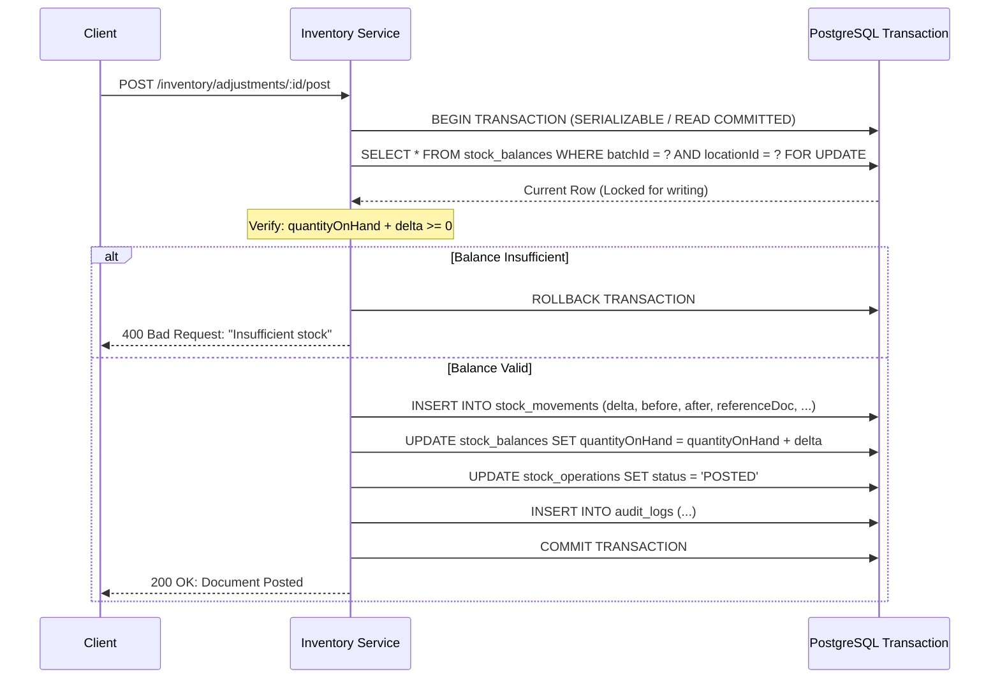

# Phase 2: Stock Ledger & Concurrency Architecture

## Overview
The Stock Movement Ledger is the permanent, append-only historical audit trail for all physical and administrative inventory changes in the medical store.

## 1. Core Principles of the Ledger
1. **Append-Only Immutability**:
   Once a row is created in `stock_movements`, it can NEVER be updated or deleted.
2. **Double-Entry Traceability**:
   Every stock balance change MUST be accompanied by an exact corresponding `StockMovement` row. Direct `UPDATE stock_balances SET quantityOnHand = ...` without an associated movement is forbidden.
3. **Compensating Transactions**:
   Mistakes, damage, or counting variances are never rolled back by deleting ledger records; they are reversed or corrected with compensating movements (`ADJUSTMENT_IN`, `ADJUSTMENT_OUT`, `STOCK_COUNT_VARIANCE`).
4. **Idempotency**:
   Every state-altering API call accepts an `idempotencyKey`. If a network retry occurs with the same key, the existing document is returned without executing duplicate movements.

## 2. Movement Types
The system supports the following standard Phase 2 movement types:
- `OPENING_STOCK`: Initial stock establishment during onboarding.
- `ADJUSTMENT_IN`: Administrative increase (e.g. found stock, return from counter).
- `ADJUSTMENT_OUT`: Administrative decrease (e.g. lost stock, administrative write-off).
- `DAMAGE`: Physical damage, broken ampoules, contaminated packaging.
- `EXPIRED`: Removal of expired stock from active dispensing.
- `TRANSFER_IN`: Stock arriving at a destination location from another store location.
- `TRANSFER_OUT`: Stock leaving a source location destined for another location.
- `STOCK_COUNT_VARIANCE`: Physical audit reconciliation delta.

## 3. Concurrency Control & Row-Level Locking Algorithm
To prevent race conditions, overselling, and negative balances during simultaneous requests:



### PostgreSQL Row-Level Lock
```sql
-- Executed inside transaction:
SELECT "id", "quantityOnHand"
FROM "stock_balances"
WHERE "batchId" = $1 AND "locationId" = $2
FOR UPDATE;
```
If two operations target the same batch and location simultaneously, the second transaction blocks until the first completes. It then evaluates the fresh committed balance, preventing phantom reads and negative inventory.

## 4. Reconciliation Service
An automated reconciliation routine (`reconcileStockBalances`) calculates the expected inventory by summing all ledger movements:
$$\text{Expected Balance} = \sum \text{quantityChange}$$
If a discrepancy between `stock_balances.quantityOnHand` and $\sum \text{quantityChange}$ is found, an alert is reported without silently altering data.
