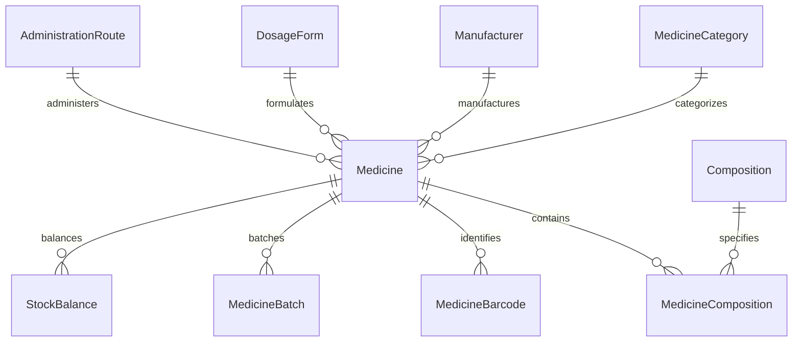

# Phase 2: Medicine Master Data Model

## Overview
The Medicine Master module in Enterprise Medical Store Management System acts as the single source of truth for all pharmaceutical formulations, salts, manufacturers, packaging hierarchies, and barcodes.

## 1. Entity Relationship Overview
The database architecture employs PostgreSQL via Prisma ORM, strictly enforcing referential integrity, decimal quantities, and unique constraints.

## 2. Core Entities

### Medicine (`medicines`)
- **ID (`id`)**: UUID Primary Key.
- **Internal SKU (`sku`)**: Unique alphanumeric identifier (e.g., `MED-PCM-500`).
- **Brand/Trade Name (`brandName`)**: Commercial packaging name (e.g., `Calpol 500mg`).
- **Generic Name (`genericName`)**: Active pharmaceutical name (e.g., `Paracetamol`).
- **Display Name (`displayName`)**: Full auto-formatted title for bills and labels.
- **Category ID (`categoryId`)**: Foreign key to `MedicineCategory`.
- **Manufacturer ID (`manufacturerId`)**: Foreign key to `Manufacturer`.
- **Dosage Form ID (`dosageFormId`)**: Foreign key to `DosageForm` (TABLET, CAPSULE, SYRUP, etc.).
- **Administration Route ID (`administrationRouteId`)**: Foreign key to `AdministrationRoute` (ORAL, TOPICAL, etc.).
- **Packaging Units**:
  - `baseUnit`: Atomic dispensing unit (`TABLET`, `ML`, `VIAL`).
  - `packUnit`: Commercial shipping unit (`STRIP`, `BOTTLE`, `BOX`).
  - `unitsPerPack`: Precise conversion factor (`Decimal(12, 4)`).
- **Regulatory & Tax**:
  - `prescriptionRequired`: Boolean flag (true for Rx products).
  - `regulatoryCategory`: Configurable Indian classification (`SCHEDULE_H`, `SCHEDULE_H1`, `SCHEDULE_X`, `OTC`, `GENERAL`).
  - `hsnCode`: Harmonized System of Nomenclature code for pharmacy tax reporting (e.g., `3004`).
  - `gstRate`: Applicable GST percentage (e.g., `5.00` or `12.00`).
- **Inventory Settings**:
  - `minStockLevel`: Reorder alert threshold (`Decimal(12, 2)`).
  - `storageConditions`: Environmental instructions (e.g., `Store below 25°C in a dry place`).
  - `sideEffects`: Informational contraindications.
  - `isActive`: Soft-delete/active state indicator.

### Medicine Composition (`medicine_compositions`)
Supports multi-ingredient active chemical salts:
- `medicineId`: Foreign key to `Medicine`.
- `compositionId`: Foreign key to `Composition` (e.g., `Paracetamol`, `Caffeine`).
- `strength`: Numerical potency (e.g., `500.00`).
- `unit`: Potency unit (`mg`, `ml`, `mcg`, `IU`).

### Medicine Barcode (`medicine_barcodes`)
Multiple barcodes per medicine with packaging conversion:
- `barcode`: Unique barcode string (EAN-13, UPC-A, Code-128).
- `packagingType`: `BASE_UNIT` (single tablet/vial) vs `PACK` (strip/box).
- `isActive`: Boolean flag.

## 3. Data Integrity & Validation Rules
1. **Case-Insensitive Uniqueness**: SKUs and barcodes are validated for uniqueness across active medicines.
2. **Decimal Precision**: All conversion factors, tax rates, and thresholds use PostgreSQL `DECIMAL` to prevent IEEE-754 floating-point inaccuracies.
3. **Audit Tracking**: Creation and updates trigger audit log events with actor ID and diff payloads.
